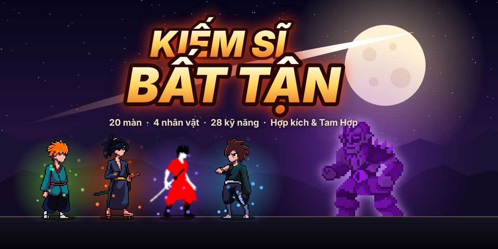

<!-- PROTOTYPE - NOT FOR PRODUCTION -->
<!-- Question: Chạy, đạp tường, nhảy đôi, lướt chém, combo + 20 màn quái/boss + kỹ năng và hợp kích kiểu MOBA trên điện thoại có "đã tay" không? -->
<!-- Date: 2026-11-03 -->

# Kiếm Sĩ Bất Tận: bản thử

**Trạng thái:** đang thử (chưa chơi thử, chưa có kết luận)

Bản thử dùng một lần rồi bỏ. Không đem code này vào game thật: nếu kết luận là
PROCEED thì viết lại từ đầu.

Bản thử đã đi qua bước 1 đến 4 trong mục "Thứ tự làm" của `game-brief.md` (di chuyển và combo,
quái và đợt, boss đổi địa hình, chọn skill). Ngoài brief còn có: 4 nhân vật chọn được, lướt chém,
40 kỹ năng khác hẳn nhau (12 nguyên tố có phản ứng chéo), Hợp Kích 2 kỹ năng và Tam Hợp Kích 3 kỹ năng,
nâng cấp ★, 4 boss, 20 màn, màn tiêu đề, **sảnh chính với 6 ô trang bị** (rơi từ quái / boss, mua, nâng cấp, đổi ngoại hình)
và **lướt + đánh** (lướt hủy đòn, chuỗi lướt chém 3 lần). **Có âm thanh + nhạc**, **chọn bùa sau mỗi màn** và **ngã rẽ**
(màn tinh anh / thương nhân). **Build càng mạnh, quái ra càng đông.** **Mỗi lần chơi lại
một khác:** kỹ năng lần trước chưa gặp được ưu tiên, thứ tự boss bị xáo, bục và đội hình quái mỗi màn đổi.

## Giả thuyết

> Nếu người chơi chạy, đạp tường, nhảy đôi, lướt chém, tung combo và bấm chiêu bằng nút cảm ứng kiểu MOBA
> để đánh qua 20 màn (16 màn quái, 4 boss), họ sẽ thấy "đã tay" và muốn chơi lại. Đo bằng: người chơi
> tự đánh tới **màn 5 (Ma Nhãn) trong lần chơi đầu**, không phải hỏi cách bấm, có **dùng chiêu trong ô và
> chiêu Hợp Kích** mà không cần nhắc, và **bấm "Chơi lại"** (thử nhân vật khác) sau khi thắng hoặc thua.
> Lần chơi thứ hai phải thấy khác lần đầu (kỹ năng mới, boss khác thứ tự) chứ không lặp lại.

**Giả định rủi ro nhất:** trên màn hình điện thoại, ngón cái phải vừa giữ cần điều khiển, vừa bấm
Chém/Nhảy/Lướt, 3 ô kỹ năng và ô Hợp Kích mà không bấm nhầm hay che mất nhân vật.

## Cách chạy

- **Link chơi cho người test (khuyên dùng):** https://thaianh111.github.io/game-moi/prototypes/kiem-si-concept/
  (tự chuyển tới `prototype.html`). Bản này tải từng phần: nhân vật, quái, icon xong là vào game ngay (có thanh %), ảnh
  boss (~2 MB) tải ngầm sau. Lần sau mở lại gần như tức thì và **chơi được khi không có mạng** (service worker `sw.js`).
- **Cài như app (PWA):** Chrome Android: menu ⋮ → "Cài đặt ứng dụng" (hoặc nút 📲 trong ⚙ Cài đặt ở sảnh); iPhone Safari:
  Chia sẻ ⬆ → "Thêm vào MH chính". Mở từ biểu tượng là chạy toàn màn hình, cầm ngang (`manifest.webmanifest`, `icons/`).
- **Bản một file:** `python3 build-standalone.py` gói `prototype.html` + `sprites/` (ảnh + âm thanh) thành `kiem-si-bat-tan.html`
  (~5,8 MB). Bấm đúp là chơi, gửi qua Zalo / Messenger được. File có sẵn trong repo; sửa game thì build lại rồi commit cùng.
- **Sau khi sửa game** chạy cả `python3 build-standalone.py` và `python3 build-pwa.py` (tạo lại `sw.js` với phiên bản mới để
  máy người chơi tự cập nhật).
- Mở thẳng `prototype.html` bằng `file://` vẫn chơi được, nhưng **Kiếm Sĩ không có lưỡi kiếm nguyên tố** và dùng tiếng tạo
  bằng code (trình duyệt chặn đọc file rời).

### Cài đặt (⚙ ở sảnh)

- **Đồ họa:** Tự động (mặc định: khung hình trung bình chậm hơn 26 ms trong 4 giây trận đấu thì tự chuyển sang Nhẹ), Đẹp, Nhẹ
  (vẽ ở độ phân giải 1×, tối đa 260 hạt hiệu ứng thay vì 900, bớt hạt môi trường).
- **Âm thanh** bật / tắt.
- **Mã lưu tiến trình:** mã `KSBT1.…` chứa toàn bộ vàng, đồ, cấp, thành tựu. Sao chép để giữ, dán vào máy khác để khôi phục
  (dữ liệu chỉ nằm trong trình duyệt, xóa dữ liệu trình duyệt là mất nếu không giữ mã).

### Điều khiển (kiểu MOBA)

| Việc | Cảm ứng | Bàn phím |
|---|---|---|
| Chạy | **cần điều khiển** nửa trái màn hình (chạm đâu hiện cần ở đó) | ← → hoặc A D |
| Nhảy / **nhảy đôi** (bấm thêm lần nữa trên không; Ninja nhảy được 3 lần) | Nhảy | Space, Z, K, ↑, W |
| Rơi xuống khỏi bục | kéo cần xuống + Nhảy | ↓/S + Nhảy |
| Chém (bấm liên tục = 3 nhát) | Chém (nút to) | X, J |
| Lướt | Lướt | C, L, Shift |
| **Lướt chém** | bấm Chém trong lúc lướt; bấm Chém tiếp lúc gần hết đà để nối, tối đa 3 lần | |
| **Lướt hủy đòn** | đang chém bấm Lướt: hủy đòn để né, lướt xong chém tiếp vẫn giữ nhịp combo | |
| Chiêu ô 1 / 2 / 3 | 3 ô kỹ năng xếp vòng cung quanh nút Chém | 1 / 2 / 3 (hoặc U / I / O) |
| **Hợp Kích** | ô vàng ở vòng ngoài (sáng lên khi đầy năng lượng) | 4, F, P |
| Bám tường | đang rơi, giữ cần hướng vào tường | |
| Đạp tường | Nhảy khi đang ở sát tường trên không | |
| Lướt-nhảy | Nhảy trong lúc lướt (bay xa hơn) | |

Ngón bấm lăn được giữa Chém/Nhảy/Lướt mà không cần nhấc tay. Ô kỹ năng phải chạm thẳng (lăn qua không tính)
để khỏi tung chiêu nhầm. Ô kỹ năng có icon, vòng hồi chiêu và số giây còn lại; ô 2 khóa 🔒 tới khi hạ Ma Nhãn,
ô 3 khóa tới khi hạ Hỏa Long.

⚙ mở bảng chỉnh thông số (tốc độ chạy, lực nhảy, lực nhảy đôi, trọng lực, trượt tường, đạp tường,
lướt, tốc độ chém, khựng hình, thời gian hồi chiêu, tốc độ quái, sát thương quái, cỡ nút). Giá trị được
nhớ trong trình duyệt. Kéo "Sát thương quái" về 0 là bất tử để thử.

## Âm thanh và nhạc

**Âm thanh thật:** tiếng trúng đòn, chí mạng, quái chết, nổ, lướt, bị đánh, chạm đất, nhặt vàng / đồ, bấm nút, chọn bùa,
lên cấp, tiếng boss xuất hiện / chết, thua trận lấy từ các gói **Kenney** (Impact, Interface, RPG Audio..., CC0). Nhạc trận và
nhạc boss là **"Battle Theme A" của cynicmusic** (CC0, boss phát nhanh hơn 7%). Cả hai lấy qua gói npm
`@netforge/asset-library-files` 0.2.0, đã đổi sang MP3 mono (`sprites/audio/`, kèm `CC0-1.0.txt`, `NOTICE-audio.txt`) để chạy
được trên iPhone. CC0 nên dùng thoải mái, kể cả game bán, không bắt buộc ghi tên.

Tiếng chưa có file (vung kiếm, sét, tung chiêu, hợp kích, còi WARNING...) và nhạc sảnh vẫn tạo bằng Web Audio; khi không tải
được file (mở `prototype.html` rời bằng `file://`) thì mọi tiếng quay về bản tạo bằng code. Tiếng tạo bằng code gồm: tiếng chém, trúng đòn, chí mạng, quái chết,
nổ, sét, lướt, nhảy, tung chiêu, hợp kích, bị đánh, chặn đòn, nhặt vàng / đồ, phản ứng nguyên tố, chọn bùa, còi WARNING boss,
tiếng gầm khi boss chết, nhạc thắng / thua, tiếng bấm nút. Nhạc nền tự soạn theo nhịp, 3 bài: **sảnh** (chậm, hợp âm êm),
**trận** (128 nhịp/phút), **boss** (150 nhịp/phút, tối hơn). Nút 🔊 / 🔇 ở góc trên (trong trận) và trên thanh sảnh; lựa chọn được nhớ.
Trình duyệt chỉ cho phát tiếng sau lần chạm đầu tiên, nên màn tiêu đề im lặng tới khi chạm.

## Bùa và ngã rẽ (sau mỗi màn quái)

Xong mỗi màn quái thì **chọn 1 trong 3 bùa**. Bùa cộng dồn tới hết trận, ưu tiên hiện bùa chưa có. Có 18 bùa:

| Bùa | Tác dụng (mỗi tầng) |
|---|---|
| 🗡️ Lưỡi Sắc / 🎯 Mắt Ưng / ✋ Tay Nhanh | Công +8% / Chí mạng +5% / Tốc đánh +8% |
| 👟 Chân Gió / 🛡️ Da Đồng / ❤️ Sinh Lực | Tốc chạy + lướt xa +8% / Giảm sát thương 8% / Máu tối đa +15 |
| 🩸 Hút Hồn / 🧘 Tĩnh Tâm / 💢 Nộ Khí | Hút máu +1,5% / Giảm hồi chiêu 8% / Nạp hợp kích +15% |
| 🔨 Trọng Kích | Sát thương chí mạng +25% |
| 🔥 Lướt Lửa | Lướt để lại vệt lửa trên sàn |
| ⚡ Lướt Sấm | Lướt chém gọi sét đánh con quái trúng đòn |
| 🌙 Kiếm Vọng | 12% nhát chém bắn thêm kiếm khí |
| 💰 Tham Vàng | Vàng +30% |
| 🍖 Thực Hồn | Hạ quái 20% hồi 2 máu |
| 💥 Xác Nổ | Quái chết 15% nổ lan |
| 🔰 Hộ Thân Phù | Đầu mỗi màn có khiên chặn 1 đòn |
| 🔋 Khởi Động | Đầu mỗi màn có sẵn 30% năng lượng hợp kích |

Sau khi chọn bùa, nếu màn sau không phải boss thì 45% gặp **ngã rẽ**:
- **Đường thường:** đi tiếp.
- **Đường tinh anh:** một nửa số quái thành tinh anh; vàng ×2, rơi trang bị ×3; xong màn được chọn **thêm 1 bùa**.
- **Thương nhân** (60% có mặt): tiêu vàng nhặt trong trận để mua trà hồi 35 máu (40), 1 bùa (70), nâng ★ một kỹ năng (150).
  Vàng tiêu ở đây không mang về sảnh.

Màn kết thúc liệt kê các bùa đã lấy.

## 4 vùng đất

Mỗi 5 màn một vùng (màn boss thuộc vùng của nó). Màn đầu của vùng ghi tên vùng và bẫy trên bảng giới thiệu màn.

| Màn | Vùng | Nền | Bẫy (chỉ ở màn quái) |
|---|---|---|---|
| 1–5 | **Rừng Đêm** | trăng, đồi xanh đêm, đom đóm | không có (vùng làm quen) |
| 6–10 | **Hang Dung Nham** | trần nhũ đá, ánh lửa dưới đáy, vết nứt dung nham, tàn lửa bay | **Đá rơi:** 4,5–6,5 giây một lần, 3 vạch đỏ báo trước 1,1 giây (1 vạch ngay chỗ mình), đá rơi trúng mình mất máu, trúng quái cũng gây sát thương |
| 11–15 | **Đền Băng** | trăng băng, cột băng, nhũ băng, tuyết rơi | **Sàn trơn:** tăng / giảm tốc trên sàn chỉ còn 22% (chạy khó dừng, khó quay đầu), bù lại lướt xa hơn 15% |
| 16–20 | **Thành Ma** | trăng xanh lục, tháp đổ nát, bia mộ | **Sương mù:** chỉ sáng quanh người chơi (màn boss sáng rộng hơn); **hồn ma** bay chậm đuổi theo, chạm là mất máu, chém tan được |

Vô Tận lặp lại 4 vùng theo đúng thứ tự mỗi vòng.

## Hướng dẫn lần đầu

Lần đầu bấm **VÀO TRẬN** là vào màn tập 8 bước, có khung chữ trên cùng và vòng vàng nhấp nháy quanh nút cần bấm:
chạy → nhảy đôi → bám / đạp tường → combo 3 nhát → lướt → lướt chém → tung chiêu (cho sẵn Hỏa Kiếm) → hạ hết bù nhìn.
Bù nhìn không đánh lại, mình không mất máu. Nút **Bỏ qua ›** để vào trận ngay; nút 📘 ở sảnh để tập lại.

## Chế độ Vô Tận

Chọn **Thường / Vô Tận** cạnh nút VÀO TRẬN. Vô Tận: hạ trùm màn 20 không thắng mà sang **vòng sau** (chọn 1 bùa thưởng,
hồi đầy máu, thứ tự boss xáo lại). Mỗi vòng: máu quái +80%, tốc độ +8%, thêm 12% quái tinh anh, máu boss +90%, đòn boss +25%.
Đủ 3 kỹ năng thì phần thưởng boss là nâng ★, hết kỹ năng để nâng thì chọn bùa. Chết là hết, màn kết thúc ghi vòng / màn đã tới
và kỷ lục xa nhất.

## Cấp nhân vật, nhiệm vụ ngày, thành tựu, hào quang

- **Cấp nhân vật:** hết trận được kinh nghiệm = quái × 2 + màn đã tới × 15 + boss × 60 (+200 nếu thắng). Mỗi cấp được 1
  **điểm tiềm năng** (tab Nhân vật): Sức mạnh (Công +3%), Thể lực (Máu +8), Nhanh nhẹn (Tốc đánh +2%, tốc chạy +1,5%),
  Tinh tường (Chí mạng +1%). Đặt lại điểm miễn phí. Mỗi nhân vật lên cấp riêng.
- **Nhiệm vụ ngày** (tab Nhiệm vụ): 3 nhiệm vụ mỗi ngày (ví dụ hạ 120 quái, gây 25 phản ứng, lướt chém ×3 6 lần), cộng dồn
  qua các trận trong ngày, nhận 150–200 vàng. Tab có chấm đỏ đếm số thưởng chưa nhận.
- **Thành tựu:** 13 thành tựu (hạ 100 / 1000 quái, thắng, thắng với cả 4 nhân vật, 100 phản ứng, Tam Hợp, đồ Huyền thoại,
  đồ +10, Vô Tận vòng 2, 10 bùa một trận, cấp 10...). Mỗi cái thưởng vàng và mở một **hào quang**.
- **Hào quang:** chọn ở tab Nhân vật; quầng sáng + hạt bay lên dưới chân nhân vật trong trận và trong sảnh (có loại cầu vồng).

## Sảnh chính và trang bị

Chạm màn tiêu đề là vào **sảnh chính** với 3 tab và nút **VÀO TRẬN**:

- **Nhân vật:** cột trái chọn 1 trong 4 nhân vật; giữa là nhân vật đứng thở với trang bị đang mặc, 6 ô trang bị xếp
  hai bên; phải là bảng chỉ số (gốc + phần cộng từ trang bị). Chạm một ô để xem món đang mặc, **nâng cấp** (+1 tới +10,
  mỗi cấp +12% chỉ số), **tháo**, hoặc **mặc** món khác cùng ô trong túi.
- **Túi đồ:** mọi trang bị, mặc cho nhân vật đang chọn hoặc **bán** lấy vàng (món đang mặc không bán được).
- **Cửa hàng:** 6 món (mỗi ô 1 món, độ hiếm ngẫu nhiên), mua bằng vàng; mua món cho ô đang trống thì mặc luôn.
  Làm mới tốn 30 vàng; chơi xong mỗi trận cửa hàng tự đổi hàng.

| Ô | Chỉ số chính | Ngoại hình trên nhân vật |
|---|---|---|
| Vũ khí | Công % | Đốm sáng màu vũ khí quanh lưỡi kiếm khi đứng / chém (từ độ Hiếm) |
| Mũ | Máu | Sừng (Thường, Hiếm) hoặc vương miện (Sử thi, Huyền thoại) lơ lửng trên đầu |
| Áo giáp | Giảm sát thương % | Phủ màu áo lên cả thân nhân vật |
| Găng | Tốc đánh % | Tia lửa màu găng khi chém trúng |
| Giày | Tốc chạy % | Vệt sáng màu giày dưới chân khi chạy / lướt |
| Ngọc bội | Giảm hồi chiêu % | Vòng hào quang có 4 hạt xoay dưới chân |

**Độ hiếm:** Thường (xám, ×1), Hiếm (xanh, ×1,6, +1 chỉ số phụ), Sử thi (tím, ×2,4, +2), Huyền thoại (cam, ×3,5, +3).
Chỉ số phụ lấy ngẫu nhiên trong: Công, Máu, Chí mạng, Tốc đánh, Tốc chạy, Giảm sát thương, Lướt xa, Hút máu, Giảm hồi chiêu,
Nạp hợp kích. Mỗi món mang một **hệ màu** (Hỏa Viêm, Lôi Thần, Băng Tinh, Mộc Linh, Kim Long, Huyết Ma, Ám Dạ, Bạch Ngọc)
quyết định màu ngoại hình và tên món.

**Có đồ từ đâu:** quái rơi vàng (tinh anh rơi nhiều hơn, 15% rơi trang bị), boss rơi 80–320 vàng và chắc chắn 1 trang bị
(boss sau rơi đồ hiếm hơn). Vàng và đồ hút về người chơi, tên món hiện màu theo độ hiếm. Hết trận (thắng hay thua) thì
vàng + đồ nhặt được vào túi. Lần đầu chơi có sẵn 300 vàng và 1 thanh kiếm Thường. Mỗi nhân vật mặc đồ riêng; một món chỉ
mặc được cho một người. Dữ liệu lưu trong trình duyệt (`ksbt-save`).

## Nhân vật (chọn ở sảnh)

| Nhân vật | Lối đánh | Khác biệt |
|---|---|---|
| **Kiếm Sĩ** | Cân bằng | Lưỡi kiếm cháy rực / toé điện / sáng xanh / đóng băng theo kỹ năng nguyên tố |
| **Samurai** | Đòn nặng | Sát thương +25%, chí mạng +15%, tầm chém xa nhất; chạy chậm hơn 5% |
| **Ninja** | Nhanh nhất | Chạy +15%, lướt xa +20%, **nhảy 3 lần liền**; sát thương −15% |
| **Võ Sĩ** | Đấm liên hoàn | Đánh nhanh +35%, mỗi cú thêm 1 dòng sát thương, cứ 20 cú trúng hồi 4 máu; tầm ngắn, sát thương −20% |

Kỹ năng và hợp kích dùng chung cho cả 4. Samurai / Ninja / Võ Sĩ có hiệu ứng nguyên tố quanh vũ khí
(lửa, tia điện, băng) chứ không tô màu lưỡi kiếm như Kiếm Sĩ.

**Lướt chém:** bấm Chém trong lúc lướt là phóng tới chém 3 dòng sát thương, để lại bóng mờ, làm quái
choáng 0,5 giây. Bấm Chém tiếp lúc gần hết đà là nối lướt chém (đổi hướng được), tối đa 3 lần; lần 3 là đòn kết
("LƯỚT CHÉM ×3!", 4 dòng, hất văng). **Lướt hủy đòn:** đang chém bấm Lướt là bỏ đòn để lướt né, lướt xong bấm Chém thì
ra nhát tiếp theo của combo chứ không quay lại nhát 1. Ai cũng có.

## Vòng chơi: 20 màn

0. **Màn tiêu đề** (banner game) → chạm → **sảnh chính** (chọn nhân vật, mặc đồ) → **VÀO TRẬN**.
1. **Chọn 1 kiếm nguyên tố khởi đầu** (3 thẻ trong 12 kiếm nguyên tố) → vào ô 1.
2. **Màn 1–4: diệt quái.** **Màn 5: boss** → hồi đầy máu, **chọn thêm 1 kỹ năng** (3 thẻ trong 40) → ô 2.
3. **Màn 6–9: diệt quái.** **Màn 10: boss** → hồi đầy máu, chọn thêm 1 kỹ năng → ô 3.
4. **Màn 11–14: diệt quái.** **Màn 15: boss** → hồi đầy máu, **nâng cấp ★ 1 kỹ năng đang có**
   (hồi chiêu nhanh hơn 30%, chiêu mạnh hơn 50%).
5. **Màn 16–19: diệt quái.** **Màn 20: trùm cuối.** Hạ xong là thắng.

Lúc chọn kỹ năng, thẻ nào mở được Hợp Kích mới sẽ ghi "Mở hợp kích: …". Qua mỗi màn quái được hồi 25 máu.
Hết máu thì thua. Thắng hay thua đều hiện nhân vật, điểm, số quái, thời gian, kỹ năng (có ★),
thứ tự boss đã gặp, vàng và trang bị nhặt được, **kỷ lục**, nút **Về sảnh** và **Chơi lại** (cùng nhân vật).

### Build càng mạnh, quái càng đông

**Sức mạnh build** = số kỹ năng + số kỹ năng ★ + 1 nếu đủ 3 kỹ năng (Tam Hợp). Từ đó ra **áp lực** = 1 + 0,22 × (sức mạnh − 1),
hiện trên thanh màn ("Áp lực ×1.4") và bảng giới thiệu màn:

| Lúc | Sức mạnh | Áp lực | Màn 8 (gốc 14 quái) |
|---|---|---|---|
| 1 kỹ năng | 1 | ×1 | 14 quái, tối đa 7 con cùng lúc |
| 2 kỹ năng | 2 | ×1,22 | ~17 quái, 9 con cùng lúc |
| 3 kỹ năng | 4 | ×1,66 | ~23 quái, 13 con cùng lúc |
| 3 kỹ năng + 1 ★ | 5 | ×1,88 | ~26 quái, 15 con cùng lúc |

Mỗi bậc sức mạnh: thêm đợt quái chen vào giữa màn (lấy từ các đợt của màn đó), đợt thêm có 7% mỗi con thành tinh anh,
thêm 2 con được đứng trên sân cùng lúc, quái ra dồn hơn, máu quái +6%, tốc độ +3%, máu boss +8%.

### Mỗi lần chơi một khác

- **Kỹ năng xoay vòng:** game nhớ các thẻ kỹ năng đã hiện ở lần chơi trước (lưu trong trình duyệt). Lần sau thẻ chưa
  gặp được ưu tiên, có nhãn vàng **MỚI**. Trong cùng một lần chơi, thẻ đã hiện mà không chọn cũng không hiện lại
  (trừ khi hết thẻ). Mỗi lần chơi hiện tối đa 9 thẻ trên 40, nên 4 lần liền không trùng thẻ nào.
- **Thứ tự 4 boss xáo ngẫu nhiên**, và không con nào đứng lại đúng màn của lần trước. Boss ra càng muộn càng trâu
  và đánh đau hơn, nên con nào làm trùm cuối cũng khó:

  | Ô boss | Máu | Sát thương | Rồng con Long Vương gọi ra |
  |---|---|---|---|
  | Màn 5 | 90.000 | x0,8 | thường |
  | Màn 10 | 150.000 | x1 | thường, trâu hơn |
  | Màn 15 | 205.000 | x1,12 | tinh anh (nếu là Hắc Long Vương) |
  | Màn 20 | 260.000 | x1,25 | tinh anh (nếu là Hắc Long Vương) |

  Ma Nhãn ở màn 15/20 bắn thêm 2 viên mỗi chùm. Hỏa Long và Hắc Long Vương luôn có bố cục bục cao để né dung nham.
- **Bố cục bục:** 7 bố cục (thêm bậc thang, hai tháp, rải rác), mỗi màn bốc một cái, hai màn liền nhau không trùng.
- **Đội hình quái:** đợt đầu của màn có quái mới giữ nguyên để giới thiệu. Các đợt sau: mỗi con có 50% bị đổi sang
  loại quái khác **đã mở khóa tới màn đó** (quái bay chỉ ra từ trên cao, quái đất ra từ cổng / trời / bục), cổng trái
  phải đảo ngẫu nhiên, thứ tự các đợt xáo lại. Tinh anh vẫn giữ là tinh anh.

| Màn | Quái mới (đợt đầu) |
|---|---|
| 1 | Heo Rừng |
| 2 | Ong Vò Vẽ bay lượn rồi lao xuống chích |
| 3 | Heo Bom: lại gần là nổ; chém chết thì nổ lan sang quái khác |
| 4 | Ốc Độc đứng trên bục phun axit vòng cung |
| 5 | **Boss** |
| 6 | Ốc Giáp: thụt vào vỏ lăn tới, trong vỏ chỉ ăn 25%; chém lúc nó thò đầu ra choáng |
| 7 | Ong Chúa Độc lơ lửng trên cao bắn kim độc |
| 8–9 | Đủ loại từ mọi phía; màn 9 có quái tinh anh (viền vàng: máu x2,4, đau x1,3, to hơn) |
| 10 | **Boss** |
| 11 | **Nhẫn Giả Bóng** (ninja tím): ở xa ném phi tiêu, lại gần chém nhanh, mình đứng trên bục thì nó nhảy lên đuổi |
| 12 | **Lãng Khách** (kiếm khách áo đỏ thẫm): thấy mình vung kiếm trước mặt là giơ kiếm đỡ (chỉ ăn 25%) rồi phản đòn |
| 13–14 | Nhẫn giả và lãng khách cùng kéo đến, tinh anh khắp nơi |
| 15 | **Boss** |
| 16 | **Hỏa Long Binh** (rồng con): đi tới phun lửa tầm gần, rất trâu, ít bị đẩy lùi |
| 17–19 | Dồn dập, rồi gần như toàn tinh anh |
| 20 | **Trùm cuối** |

Từ màn 11 trở đi máu và tốc độ quái tăng dần (x1,65 → x2,4 máu). Quái ra theo **nhóm** từ 4 kiểu chỗ: cổng chân
tường hai bên, mép trên (quái bay), **rơi từ trời** và **hiện trên bục**. Hai kiểu sau có dấu báo đỏ nhấp nháy trước 0,9 giây.
Màn ngay trước boss ghi tên boss sắp gặp trên bảng giới thiệu màn.

### Boss

Boss nào cũng có bảng WARNING đỏ trước khi ra (trùm cuối ghi thêm "TRÙM CUỐI"), thanh máu đầy dần, nổ dây chuyền khi chết.

- **Ma Nhãn:** rơi từ trên cao đáp đất nổ tung. Bay lượn, gồng mắt bắn chùm cầu (chém vỡ được), biến mất
  thì xếp lại bục. Máu càng thấp càng hay dịch chuyển và bắn dày hơn.
- **Hỏa Long:** quái thú chui lên khỏi mặt đất rồi gầm. Cào móng, phun lửa (vùng lửa đo theo từng khung
  hình), nhảy bổ xuống tạo sóng chấn. **Gầm lên thì sàn hóa dung nham** ("LÊN BỤC!"); máu càng thấp càng hay gầm.
  Bị đánh dồn đủ đau thì khựng lại một nhịp.
- **Long Vương:** hồn rồng sà từ trời xuống, đáp đất rồi gầm. Đòn đánh:
  - Cào móng khi mình đứng gần
  - **Gọi hồn rồng:** dấu đỏ hiện dưới sàn, 1 giây sau cột lửa phun lên đúng chỗ đó
  - Ném 3 quả cầu lửa vòng cung rải quanh chỗ mình đứng (chém vỡ được)
  - Còn 2/3 và 1/3 máu thì gọi 2 Hỏa Long Binh từ hai cổng
- **Hắc Long Vương:** Long Vương bản tím đen, đánh nhanh hơn. Ném 5 cầu lửa, mỗi lần
  gọi cột lửa thì **xếp lại bục**, dưới 60% máu thì **gầm hóa sàn thành dung nham**, gọi rồng con 3 lần
  (75%, 50%, 25% máu).

## Kỹ năng: 40 kỹ năng, mỗi cái một cơ chế riêng

Mỗi kỹ năng có thụ động (luôn chạy) + chiêu bấm trong ô (có hồi chiêu), một icon riêng không trùng. Tung chiêu thì có
vòng sáng màu kỹ năng và tên chiêu bay lên trên đầu. Thẻ chọn ghi loại kỹ năng (Nguyên tố, Triệu hồi, Khống chế…).

**12 kiếm nguyên tố** (kỹ năng khởi đầu; đổi màu lưỡi kiếm của Kiếm Sĩ, toả hạt hiệu ứng quanh vũ khí của mọi nhân vật):

| Kỹ năng | Thụ động | Chiêu (hồi) |
|---|---|---|
| 🔥 Hỏa Kiếm | Chém làm quái bỏng 2 giây | Hỏa Long Xung: lao vút tới xuyên quái, để lại vệt lửa cháy 3 giây trên sàn (8s) |
| ⚡ Lôi Kiếm | Chém trúng thì sét lan sang 3 con gần đó | Lôi Phạt: sét trời đánh 6 con gần nhất (9s) |
| ❄️ Băng Kiếm | Chém làm quái chậm một nửa 2 giây | Băng Hoa: nổ băng, gai băng trồi khỏi sàn, đóng băng quái 2,5 giây (9s) |
| 🌙 Kiếm Khí | Mỗi nhát chém bắn luồng kiếm bay xa | Vạn Kiếm: 5 luồng kiếm xoè hình quạt (7s) |
| 🧪 Độc Kiếm | Mỗi nhát chồng 1 tầng độc (tối đa 5), độc dày rút máu nhanh | Độc Vụ: ném lọ độc vòng cung, vỡ thành mây độc 4 giây làm chậm và trúng độc (9s) |
| ✨ Quang Kiếm | Chí mạng nổ chớp sáng lan sang quái quanh đó | Thánh Quang Trụ: cột sáng từ trời quét qua lại đấu trường 1,7 giây (10s) |
| 🩸 Huyết Kiếm | Máu càng thấp đánh càng đau (tới +60%) | Huyết Cuồng: đổi 10 máu lấy 6 giây đánh nhanh và mạnh hơn 40%, chém trúng hút máu (14s) |
| 🌑 Ám Kiếm | Chém sau lưng quái +60% và luôn chí mạng ("SAU LƯNG!") | Ảnh Sát: hiện sau lưng 5 con gần nhất, chém từng con (10s) |
| 🌊 Thủy Kiếm | Chém làm quái **ướt** 3 giây và văng xa hơn | Thủy Long Ba: con sóng cuốn dọc sàn, dồn quái vào tường, làm ướt (9s) |
| 🌿 Mộc Kiếm | Chém **gieo hạt**, 1,2 giây sau hạt nở: gây sát thương và trói chân | Đằng La Trận: dây leo trói mọi quái trên sàn quanh mình 2 giây (10s) |
| ⛰️ Thổ Kiếm | Nhận ít hơn 25% sát thương, đòn chém làm choáng lâu hơn | Lạc Thạch: 3 tảng đá lăn dọc sàn nghiền quái (9s) |
| 🔱 Kim Kiếm | Xuyên giáp (vỏ Ốc Giáp, kiếm đỡ Lãng Khách), +30% với tinh anh và boss | Kim Cang Kiếm: kiếm vàng khổng lồ cắm từ trời xuống, nổ sóng chấn (11s) |

### Phản ứng nguyên tố (lối build)

Trạng thái một nguyên tố để lại trên quái gặp nguyên tố khác thì nổ ra phản ứng (chữ phản ứng hiện trên đầu quái,
mỗi con tối đa 1 lần / 0,8 giây, mỗi lần +4% năng lượng hợp kích). Đòn chém mang **mọi** kiếm nguyên tố đang có, chiêu
và hợp kích mang nguyên tố của nó.

| Trạng thái trên quái | Gặp | Phản ứng |
|---|---|---|
| Ướt (Thủy) | Lôi | **Điện Giật:** sét lan sang mọi quái quanh đó |
| Ướt | Băng | **Đóng Băng:** đóng băng 1,6 giây |
| Ướt | Hỏa | **Hơi Nước:** nổ hơi nước đẩy quái ra |
| Ướt | Thổ | **Bùn Lầy:** chậm 3 giây, choáng |
| Hạt / bị trói (Mộc) | Hỏa | **Bùng Cháy:** nổ lửa, cả đám bỏng 3 giây |
| Độc ≥ 3 tầng | Hỏa | **Nổ Độc:** kích nổ độc theo số tầng, lan độc sang quái bên cạnh |

Ví dụ build: Thủy + Lôi (đánh đâu giật đó), Mộc + Hỏa (trói rồi đốt), Độc + Hỏa (chồng độc rồi kích nổ), Thổ + Kim (trâu và
xuyên giáp, đánh boss).

**28 kỹ năng khác:**

| Kỹ năng | Loại | Thụ động | Chiêu (hồi) |
|---|---|---|---|
| 🛡️ Khiên Thánh | Phòng thủ | Cứ 15 giây tự chặn 1 đòn | Thánh Quang: bất tử 3 giây, đẩy văng quái (14s) |
| 💧 Linh Tuyền | Hồi máu | 4 giây không trúng đòn thì mỗi giây hồi 1 máu | Suối Hồi Sinh: hồi 30 máu trong 3 giây, đẩy quái ra (16s) |
| ⌛ Thời Không | Khống chế | Quái trong vòng đồng hồ dưới chân chậm 25% | Ngưng Đọng: 4 giây quái, đạn, boss chậm còn 1/4, màn hình ngả vàng có mặt đồng hồ (18s) |
| 🌀 Toàn Phong Trảm | Cận chiến | Chém trên không xoay một vòng, trúng cả sau lưng, +30% | Lốc Kiếm: xoay kiếm 1,2 giây (8s) |
| 🪃 Hồi Phong Đao | Phóng chiêu | Nhát 3 combo ném lưỡi gió bay ra rồi quay về | Phong Hoàn Đao: lưỡi gió lớn bay ra rồi về, kéo quái theo, trúng 2 lần (8s) |
| 🕳️ Hắc Động | Khống chế | Quái chết tạo xoáy nhỏ hút quái xung quanh lại | Hắc Động: lỗ đen hút quái 2,5 giây, đánh liên tục rồi nổ (12s) |
| ⚔️ Song Trảm | Cận chiến | Mỗi nhát thêm 1 dòng sát thương | Song Long Trảm: 2 nhát chéo khổng lồ (7s) |
| 🗡️ Phi Đao | Phóng chiêu | Mỗi lần lướt ném 3 phi đao | Đao Hoàn: 16 phi đao toả tròn (8s) |
| 🔮 Hộ Thể Cầu | Triệu hồi | 2 cầu sét xoay quanh người, chạm quái là giật, chặn được đạn | Tinh Cầu Bạo: 6 cầu, vòng rộng ra 5 giây, rồi lao vào quái nổ (11s) |
| 🦅 Thần Ưng | Triệu hồi | 1 chim thần bay theo, 4 giây bổ nhào mổ 1 con | Vạn Ưng: thêm 2 chim bổ nhào liên tục 5 giây (12s) |
| 👥 Phân Thân | Triệu hồi | 1/5 nhát chém có bóng mờ chém lặp lại | Ảnh Phân Thân: 2 bóng hai bên chém theo mọi nhát 6 giây (14s) |
| ☄️ Thiên Thạch | Diện rộng | Cứ hạ 20 quái thì 1 thiên thạch tự rơi | Mưa Thiên Thạch: 4 thiên thạch (12s) |
| ☯️ Bát Quái Trận | Bẫy | Lướt để lại 1 trận pháp (tối đa 4), quái giẫm là nổ | Bát Quái Trận: rải 6 trận pháp phía trước, tồn tại 8 giây (10s) |
| 🪨 Địa Chấn | Diện rộng | Từ trên cao đáp xuống tạo sóng chấn | Thiên Địa Chấn: bật lên rồi đập xuống (10s) |
| 🌵 Gai Đất | Diện rộng | Quái chết thì đất mọc gai đâm con bên cạnh | Địa Thứ: hàng gai lan ra phía trước (8s) |
| 🐉 Thăng Long | Khống chế | Nhát 3 combo hất quái lên trời, rơi đập đất mất thêm máu | Thăng Long Quyển: cột gió hất tung quái rồi quật xuống (9s) |

| ⛓️ Xích Hồn | Khống chế | Cứ 6 nhát trúng thì quăng xích kéo 1 con về sát mình | Xích Hồn Tỏa: móc 5 con kéo về, choáng 1 giây (9s) |
| 💨 Tật Phong | Cường hóa | Chạy nhanh hơn 15% | Tật Phong Bộ: 5 giây chạy +50%, đánh +30%, có bóng mờ, lướt để lại vệt gió chém (12s) |
| 💀 Đoạt Mệnh | Cận chiến | Chém quái dưới 30% máu luôn chí mạng | Đoạt Mệnh Trảm: lao tới con yếu nhất, quái thường dưới 35% máu chết ngay (10s) |
| 🌠 Bạch Hồng Kiếm | Phóng chiêu | Đòn chí mạng bắn kiếm khí nảy qua 2 con | Bạch Hồng Quán Nhật: kiếm khí nảy qua 8 con (8s) |
| 💥 Bạo Kích | Cường hóa | Chí mạng +12% | Cuồng Bạo: 6 nhát tới chắc chắn chí mạng, mạnh hơn 50% (11s) |
| 🗼 Phong Trụ | Triệu hồi | Cứ 18 giây tự dựng 1 trụ gió nhỏ bắn quái 4 giây | Phong Trụ Trận: trụ gió bắn liên tục 7 giây (12s) |
| 🐲 Phong Long | Triệu hồi | Cứ hạ 25 quái thì 1 rồng gió bay quét ngang sân | Phong Long Quá Hải: rồng gió quét ngang đấu trường, hất tung quái (14s) |
| 🔯 Ấn Ký | Diện rộng | Mỗi nhát in 1 ấn (chấm tím trên đầu quái), đủ 5 ấn thì nổ | Ấn Bạo: in đủ 5 ấn lên mọi quái quanh mình rồi nổ cùng lúc (10s) |
| 🕸️ Thiên La Võng | Khống chế | Chém trúng quái bay thì nó rơi xuống, choáng 1,2 giây | Thiên La Địa Võng: tung lưới trói quái 2,5 giây, kéo quái bay xuống (10s) |
| 🤺 Phản Kích | Phòng thủ | Bị trúng đòn thì tự chém trả một vòng | Thế Thủ: 1 giây thủ thế, đòn nào trúng cũng bị chặn và phản lại một nhát cực mạnh (8s) |
| 🌬️ Phong Bích | Phòng thủ | Đạn quái bay tới gần có 1/4 cơ hội bị thổi tan | Phong Bích: tường gió 4 giây chặn đạn, đẩy lùi và cứa quái (12s) |
| 🔨 Phá Giáp | Khống chế | Chém làm quái vỡ giáp 3 giây (+15% sát thương nhận) | Chấn Hống: mọi quái quanh mình vỡ giáp nặng 6 giây (+40%) và choáng (12s) |

Họ hợp kích của 12 kỹ năng mới: Xích Hồn, Tật Phong → lốc; Đoạt Mệnh, Bạch Hồng Kiếm, Bạo Kích → trăng; Phong Trụ,
Phong Long → kiếm vũ; Ấn Ký → thiên thạch; Thiên La Võng → chấn; Phản Kích, Phong Bích, Phá Giáp → ánh sáng.

### Hợp Kích (chiêu phối hợp 2 kỹ năng)

Có từ 2 kỹ năng trở lên là mở ô **Hợp Kích** (ô vàng). Ô nạp năng lượng bằng đòn đánh: mỗi đòn trúng +1,4%,
mỗi con quái chết +3%. Đầy 100% thì ô sáng và có thể tung chiêu: tên chiêu hiện chữ vàng giữa màn hình.

- **2 kiếm nguyên tố** → lốc xoáy 2 màu mang cả 2 nguyên tố, tên ghép từ 2 nguyên tố: **Lửa + Sét = Lôi Hỏa Long
  Quyển**, Độc + Lửa = Độc Hỏa Long Quyển, Ám + Băng = Băng Ám Long Quyển, Thủy + Mộc = Thủy Mộc Long Quyển… (66 cặp). Icon ô hợp kích nhuộm 2 màu.
- **Còn lại** theo họ của kỹ năng không phải nguyên tố, nhuộm màu kiếm nguyên tố đang có:

| Họ | Kỹ năng | Hợp Kích |
|---|---|---|
| Lốc | Toàn Phong Trảm, Hồi Phong Đao, Hắc Động | (Hỏa/Lôi/…/Cuồng) Phong Quyển: lốc xoáy khổng lồ hút quái |
| Trăng | Song Trảm, Phi Đao | Nguyệt Trảm: nhát trăng khuyết khổng lồ xuyên màn hình (có Song Trảm thì 2 nhát) |
| Kiếm vũ | Hộ Thể Cầu, Thần Ưng, Phân Thân | Kiếm Vũ: 12 thanh kiếm thần màu nguyên tố cắm xuống quái |
| Thiên thạch | Thiên Thạch, Bát Quái Trận | Thiên Thạch Vũ: 12 thiên thạch |
| Chấn | Địa Chấn, Gai Đất, Thăng Long | Long Chấn: sóng chấn lớn khắp sàn + gai đất |
| Ánh sáng | Khiên Thánh, Linh Tuyền, Thời Không | Quang Bạo: nổ ánh sáng lớn, hồi 20 máu, bất tử 2 giây |

Có nhiều họ thì lấy họ đứng trên trong bảng.

### Tam Hợp Kích (3 kỹ năng)

Đủ 3 kỹ năng thì ô hợp kích thành **Tam Hợp Kích**: vòng năng lượng cầu vồng, chữ "TAM HỢP KÍCH" khi tung, mạnh hơn hẳn.
Tam Hợp nào cũng kết thúc bằng **Thiên Phạt**: cột sáng màu nguyên tố giáng xuống 8 con quái gần nhất.

| 3 kỹ năng | Tam Hợp | Ví dụ |
|---|---|---|
| 3 kiếm nguyên tố | 3 lốc xoáy 3 nguyên tố từ 3 phía hội tụ về giữa rồi nổ | Lôi Băng Hỏa Tam Nguyên Quyển |
| 2 nguyên tố + 1 kỹ năng khác | Lốc xoáy 2 nguyên tố + chiêu họ của kỹ năng thứ ba | Lôi Thủy Vạn Kiếm Quy Tông |
| 1 nguyên tố + 2 kỹ năng khác | Tung liền 2 chiêu họ của 2 kỹ năng | Kim Cửu Thiên Quyển |

Chữ đuôi theo họ: Cửu Thiên Quyển (lốc), Phá Thiên Trảm (trăng), Vạn Kiếm Quy Tông (kiếm vũ), Thiên Hỏa Lạc Tinh
(thiên thạch), Liệt Địa Long Chấn (chấn), Thánh Quang Thiên Bạo (ánh sáng).

## Trong bản thử

- Đấu trường một màn hình. Hai bức tường giữ phần trên để bám/đạp tường; chân tường là cổng cho quái ra vào.
- Chạy, nhảy, **nhảy đôi** (lộn người, vòng gió dưới chân), rơi xuống khỏi bục, lướt, **lướt chém**, lướt-nhảy,
  trượt tường, đạp tường.
- Combo đất 3 nhát, chém trên không 3 nhát (Kiếm Sĩ: nhát 3 bổ xuống).
- Khựng hình, rung màn hình, chớp trắng và đẩy lùi khi bị trúng đòn, chết dùng animation chết của từng nhân vật.
- **Số sát thương kiểu MapleStory M:** mỗi đòn bật một cột số thẳng hàng, dòng sau hiện chồng lên trên.
  Màu theo loại: cam (thường), hồng + CRIT (chí mạng), đỏ cam (bỏng), tím (sét), xanh ngọc (kiếm khí),
  xanh lam (băng), nâu (đất), xanh nõn (độc), vàng (ánh sáng), đỏ (huyết), tím than (bóng tối), xám (chém vào khiên /
  Lãng Khách đỡ), tím đậm (mình mất máu), xanh lá (hồi máu), vàng "CHẶN" (Khiên Thánh chặn đòn).
- Quái bị chậm thì phủ màu xanh lam nhạt, đóng băng thì đứng yên và trắng xanh, trúng độc thì phủ xanh nõn và sủi bọt.

**Đã cắt:** âm thanh, nhạc, Màn Né Tránh, skill ẩn, boss Thụ Yêu và Băng Hậu.

## Ghi chú kỹ thuật

- Một file HTML + canvas 2D, không thư viện. Vật lý bước cố định 1/120 giây.
- Thế giới cao 360 đơn vị, rộng 560–860 theo tỉ lệ màn hình.
- **Nhân vật:** bảng `CHARS` gom mọi thứ khác nhau giữa 4 nhân vật: dải hoạt ảnh (tên logic → sheet, khung đầu/cuối,
  fps, lặp), 3 đòn đất + 3 đòn không (khung ra đòn, hộp trúng, số dòng sát thương) và hệ số chạy/đánh/lướt/chí mạng.
  Kiếm Sĩ dùng dải sprite nét mịn 128px (`ANIMS`), 3 nhân vật kia là pixel 128x128 (`SHEETS`, vẽ không làm mịn).
- Các khung chém của Kiếm Sĩ lấy từ dải sprite: vệt kiếm của AttackSwing1 ở khung 12–18, AttackSwing2 ở 9–13,
  AttackSwing3 ở 14–21. Các nhát bỏ bớt khung lấy đà đầu để bấm là ra đòn ngay (~0,13 giây).
- **Tách lưỡi kiếm (Kiếm Sĩ):** lưỡi kiếm và da tay/mặt cùng màu trắng, nên lúc tải game em lọc điểm ảnh trắng,
  co 3x3: lưỡi kiếm mảnh bị bào mất, da dày còn lại. Mảng còn lại nhỏ (< 150 điểm) là da, nở lại 2 điểm
  rồi loại ra. Sau đó tô màu theo bảng `PAL`, làm quầng sáng (tính riêng từng khung) và lưu sẵn các điểm trên lưỡi
  kiếm của từng khung để toé lửa / phóng điện / đóng băng.
- Quái dùng sprite pixel. Chớp trắng / gồng đỏ / bỏng cam / chậm / đóng băng bằng cách phủ màu lên khung qua một canvas tạm.
  Ma Nhãn vẫn vẽ bằng hình khối vì gói hình không có con nào hợp.
- Hỏa Long: khung 340x255 (bản x256p), riêng phun lửa là khung gấp đôi 680x510. Tầm móng và vùng lửa từng khung
  đo bằng script từ ảnh rồi ghi cứng trong `CLAW` / `FIRE_BOX`.
- Long Vương: sprite pixel Dragon Lord phóng to x2,2. Hắc Long Vương là bản đổi màu tím đen. Hỏa Long Binh dùng lại sprite
  này ở cỡ nhỏ.
- Lốc xoáy Hợp Kích: phễu tô gradient theo nguyên tố, 18 vòng xoáy đổi màu 2 nguyên tố, có sét (Lôi) hoặc tia sáng
  (Quang) bắn ra; trôi chậm về phía trước, dội tường, hút quái về tâm và gây sát thương mỗi 0,18 giây.
- Chiêu đặt trên sân (vệt lửa, lọ độc, mây độc, cột sáng, lỗ đen, xoáy hút, trận pháp, cột gió) nằm chung trong mảng
  `zones`, cập nhật và vẽ ở `updateZones` / `drawZones`. Chim thần ở `pets`, bóng mờ phân thân ở `ghosts`.
- Ngưng Đọng: quái, đạn, cột lửa và boss chạy với bước thời gian x0,25; người chơi vẫn bình thường.
- Xoay vòng và thứ tự boss lưu trong `localStorage` (`ksbt-seen`, `ksbt-boss`). Trình duyệt chặn lưu (chế độ ẩn danh…)
  thì vẫn chơi được, chỉ là mỗi lần đều bốc ngẫu nhiên.

- **Chống đứng hình:** vòng lặp hẹn khung hình sau trước rồi mới cập nhật / vẽ; lỗi ở cập nhật hay vẽ chỉ được ghi vào
  `window.__loopErrs` rồi game chạy tiếp. Mọi lệnh vẽ tròn / elip / gradient tròn tự kẹp bán kính âm về 0. (Lỗi cũ: vệt lửa
  Hỏa Long Xung tính ra bán kính âm ở khung cuối, vòng lặp chết, game đứng hình.) Kiểm tra bằng bot chơi ngẫu nhiên
  120 màn với bộ kỹ năng ngẫu nhiên: 0 lỗi.

## Hình

- **Kiếm Sĩ:** bộ "2D Sword Character PC" của EBros Entertainment (`sprites/*.png`). Anh Thái Anh đã
  đồng ý đưa lên repo. **Cần kiểm tra lại giấy phép trước khi phát hành.**
- **Samurai, Ninja, Võ Sĩ, Nhẫn Giả Bóng, Lãng Khách:** gói free shinobi của craftpix (`sprites/chars/`, `sprites/enemy/`).
  Nhẫn Giả Bóng (tím) và Lãng Khách (đỏ thẫm) là em đổi màu từ Ninja và Samurai.
- **Icon kỹ năng và hợp kích:** gói "Free 50 Aeromancer Skills" của craftpix (50 icon tĩnh, không có hiệu ứng động).
  Game dùng 48 icon khác nhau (40 kỹ năng + 8 hợp kích), em tô lại màu theo từng kỹ năng (`sprites/icons/`, WebP 96x96).
  Hiệu ứng chiêu đều vẽ bằng code.
  Hai gói craftpix chỉ kèm link điều khoản (`License-craftpix.txt`, `License-aeromancer.txt` → craftpix.net/file-licenses).
  **Cần đọc điều khoản trước khi phát hành, nhất là phần đưa hình lên repo công khai.**
- **Long Vương / Hắc Long Vương / Hỏa Long Binh:** gói "Dragon Lord Basic" (`sprites/dlord/`). Gói **không kèm file
  giấy phép**, cần kiểm tra nguồn trước khi phát hành.
- **Quái rừng:** heo rừng, ong, ốc sên trong gói "Legacy Fantasy - High Forest" của Anokolisa (`sprites/forest/`). Ong tím
  và ốc vỏ xanh là em đổi màu. Giấy phép (`sprites/forest/Terms-Anokolisa.txt`): dùng được cho game kể cả game bán,
  không bắt buộc ghi tên, được sửa màu; không được bán lại chính bộ hình.
- **Hỏa Long:** quái thú phun lửa trong gói `x256p_Spritesheets` (`sprites/beast/`, WebP). Gói **không kèm file giấy phép**.
- **Không dùng** gói `MegaMan_Sprite_Assets`: trong đó là nhân vật Zero của Mega Man X (Capcom), không đưa vào game được.
- `prepare-assets.py <thư mục đã giải nén>` tạo lại `sprites/forest` và `sprites/beast`.
  `prepare-assets-2.py <thư mục đã giải nén>` tạo lại `sprites/chars`, `sprites/enemy`, `sprites/dlord` và `sprites/icons`.

Ảnh chụp: `screenshot.png` (số sát thương), `screenshot-warning.png` (bảng WARNING), `screenshot-boss.png` (đánh Ma Nhãn),
`screenshot-swords.png` (kiếm lửa / kiếm sét), `screenshot-moba.png` (điều khiển MOBA), `screenshot-beast.png`
(Hỏa Long phun lửa + dung nham), `screenshot-mobs.png` (quái pixel màn 9), `screenshot-chars.png` (chọn nhân vật),
`screenshot-dslash.png` (Samurai lướt chém, màn 11), `screenshot-fusion.png` (Lôi Hỏa Long Quyển),
`screenshot-lord.png` (Hắc Long Vương ra trận, Ninja có 3 kỹ năng, 1 kỹ năng ★),
`screenshot-skills-1.png` / `-2` / `-3` (24 chiêu, mỗi ô một chiêu), `screenshot-pick.png` (lần chơi thứ 2: thẻ MỚI),
`screenshot-fusion-pair.png` (Độc Hỏa Long Quyển), `screenshot-boss-shuffle.png` (Hắc Long Vương ra ở màn 5),
`screenshot-title.png` (màn tiêu đề), `screenshot-elements.png` (Kim Cang Kiếm), `screenshot-reaction.png` (Mộc + Hỏa: Bùng Cháy),
`screenshot-tamhop.png` (Lôi Thủy Vạn Kiếm Quy Tông), `screenshot-pressure.png` (màn 8 áp lực ×1,9: 27 quái),
`screenshot-lobby.png` (sảnh: tab Nhân vật, đủ 6 món), `screenshot-shop.png` (cửa hàng), `screenshot-gear-ingame.png`
(vương miện, vòng ngọc bội, áo phủ màu trong trận), `screenshot-dashchain.png` (LƯỚT CHÉM ×3), `screenshot-dragon.png`
(Phong Long), `screenshot-end-loot.png` (màn kết thúc có vàng + đồ nhặt được).
`screenshot-tutorial.png` (hướng dẫn), `screenshot-biomes.png` (4 vùng đất), `screenshot-settings.png` (cài đặt + mã lưu), `screenshot-quests.png` (nhiệm vụ + thành tựu), `screenshot-level.png` (cấp + tiềm năng +
hào quang), `screenshot-endless.png` (Vô Tận vòng 2).

Icon trang bị vẽ bằng code (`itemIcon`: kiếm, mũ, áo, găng, giày, ngọc bội theo màu hệ, viền theo độ hiếm).

**Banner:** `banner.png` (1280x640, cỡ ảnh xem trước của GitHub) vẽ bằng chính sprite trong game: 4 nhân vật với quầng nguyên tố,
Hắc Long Vương, trăng, tên game. Vẽ lại bằng cách mở `kiem-si-bat-tan.html#banner` rồi chụp khung 1280x640 (hàm `drawTitleArt`,
dùng chung với màn tiêu đề).

## Kết luận

_(Điền sau khi chơi thử.)_
